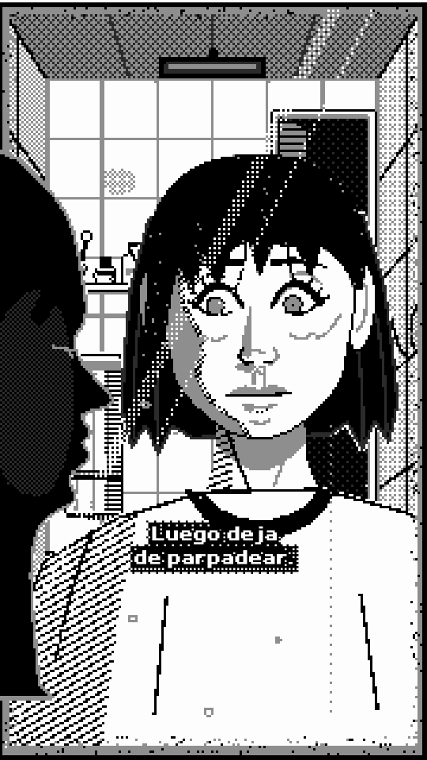

# Onebit

1-bit manga-horror pixel. Stark black and white with one flat mid grey (and a near-black for night), hard pixels, heavy black hair masses with fine strands, flat grey shadow planes with a hatched terminator, half-tone (50% Bayer) for wall tiles and ceilings, and white rims around dark silhouettes. Anatomical faces (cheekbones, nose planes, nostrils, lids and lashes, irises with a catchlight, eye bags, neck tendons, ears). Bathroom-type sets drawn flat but in one-point perspective. Hard cuts, nearly still shots, and typed subtitles in a bold white pixel font with a black outline over a dithered dark plate.

## Measured (from the references: edge-periodicity on stills + zoom crops)

- **Palette (4 steps):** ink `#000000`, night `#2b2b2b`, wall grey `#8e8e8e`, paper `#fdfdfd`. Indexes `K, DK, GR, WH`.
- **Pixel size:** the main character close-ups measure 8.05 px at 1080 (≈134x238); a wide shot of the same set measures 5.75 px (≈188x334); the bathroom reference is 2.25 px at 1280x720 (a 320-line picture). **Internal resolution: 180x320 (6 px pixels)** — it matches the finer reference shots and the 320-line bathroom reference and gives faces enough pixels for anatomy in mirror shots (face 40 px wide) while staying chunky. `obScene({ w: 135, h: 240 })` still gives the coarser 8 px look.
- **Subtitles:** cap 7 cells on a 5 px grid (35 px), vertical strokes 2 cells (10 px), 1-cell black outline plus a 1-cell drop shadow down-right, a 80%/40% dithered black plate; 2 lines max, typed at 0.045 s per glyph, no cursor.
- **Cuts:** hard cuts, one per 1.5–3.5 s; inside a shot only tiny motion on 2s (a blink, a turn, lips, a hand).

## Kit API (`kit.js`)

- `obScene(draw, { w, h, bg, cam, shake, map, light })`: low-res index buffer → upscale nearest-neighbour. `light: { amb, lights: [{ x, y, r0, r1, p }] }` darkens every non-emissive pixel by distance with Bayer dither (`v → floor(v·L + bayer)`); `amb: 0.12, lights: []` = lights out (only emissive rims/glints stay).
- `obMask(fill, fn, { thr, rim, rim8, rimDir, emit, rimEmit, noCam, noPre })`: the threshold pass; `rimDir` rims only the lit side; `emit` marks pixels the light pass must keep. Shorthands `obFill`, `obInk`, `obRect`, `obLine`, `obSpl` (smooth line), `obHatch`, `obGlow` (dithered emissive halo). Geometry: `obCR` (Catmull-Rom densify), `obAlong`, `obPoly`, `obPolyAdd`.
- Figures: `obPerson(x, y, s, { blink, stare, smile, look, shade, roll, shirt, glow, rimDir, shadowInk, noBody, key })` (y = eye line, s = half face width; `smile` → `obGrin`: uneven corners, gums, two rows of irregular teeth, lip edges, nasolabial folds and their shadow, bunched cheeks pushing tense lower lids, crow's feet), `obHand(x, y, s, { side: 'palm'|'back', mirror, flat, arm, armDx, glow })`, `obBackOfHead(x, y, s, { glow, rimDir })`, `obProfile(x, y, s, { blink })` (rim-lit foreground silhouette).
- Set: `obTiles(quad, nx, ny, { base, grout, stain, bevel })` (perspective tiles with stains, drips, cracks), `obRoomBox(frame, backWall)` (ceiling + side walls), `obLamp`, `obSink` (rim, bowl, drain, mixer tap, trap pipe), `obShelf(x, y, w, [[kind, x, h]])` (pump, round, jar, tall, cup with toothbrushes), `obTowel`, `obDoor(x, y, w, h, { open })`, `obMirror(x, y, w, h, inside, { frame, glints, wear, spots, glow })` (desilvering at the edges, water spots, a drip run).
- Text: `OB_FONT` (bold by 1-cell right dilation; advances trim empty body columns), `obSubtitle`, `obSub(lines, t0, { cx, y, plate })`, `obTypeCount`, `obTypeTimes`.

## Motion habits

- On 2s. Held shots; life is a blink (one boil), a slow push-in (<= 5%), a small head roll, a hand rising over 0.5–1 s.
- Things switch rather than fade: a lamp flickers (every 3rd boil off) and dies → the lights-out palette (silhouettes rimmed in white, eye glints, teeth).
- A shock is a hard cut plus 3 frames of whole-pixel shake.

## Frame checklist (on top of grammar/FRAME.md)

1. Only the 4 ramp colours; every edge a staircase of 6 px squares (subtitles on 5 px).
2. Big flat areas: white skin and shirts, black hair, flat grey shadow planes. Dither only for tiles, ceilings, glow and falloff; never over a whole face.
3. One light direction per shot: the shadow plane, nose plane, cast shadow under the nose and jaw all on the same side.
4. A dark mass (hair) against a lighter ground, with a white rim where it meets grey.
5. The set has 4+ props (tiles with grout and stains, sink and tap, shelf bottles, towel, door, lamp, mirror wear) but they stay line art on white so the face reads first.
6. Subtitle on its plate, 2 lines max, inside x 60-940 and above y 1500.
7. Dark scenes: near-black, dithered night forms, only emissive rims, glints and teeth bright.

## Do / don't

- Do draw with smooth canvas paths and let `obMask` snap them; give dark shapes a rim.
- Do keep faces mostly white: shading is one flat grey plane, a 1-px hatched terminator, and grey contour lines.
- Don't stack lines around the eyes (crease + bag + crow's feet + cheek contour reads as old or as goggles); with a grin drop the cheekbone line.
- Don't run the light pass with a small r0 on lit scenes: it turns everything into mid-grey mush. Use r0 ≥ 200 so only corners fall off.
- Don't name the source artists or games in output.

## Not matched yet

- The references' line weight varies more (tapered contours); ours is a constant 1 px except lids and brows.
- The bathroom reference's shading is screen-tone dots on clothes and skin too; ours keeps skin flat.
- Hands are still simple (capsule fingers); the references' hands are better.
- Reference video carries mild compression blur; ours is pixel-crisp (deliberate).

**Proven on:** `pieces/reflejo` (15 s, 6 shots, hard cuts, Spanish subtitles) — look and storyboard; export pending approval.
