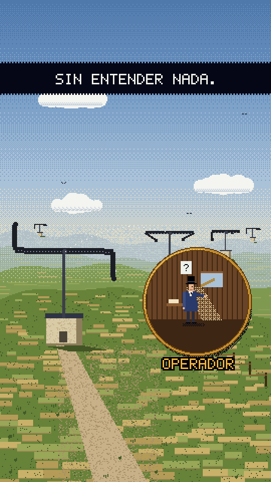

# pixdoc — documentary pixel art

Short documentary explainers in fine pixel art: a full-bleed, richly detailed world drawn at 270×480 (4 px pixels on 1080×1920), ordered dithering instead of gradients, a navy subtitle bar that types itself on, small amber labels, gilded circular loupes that open on details, old-paper maps whose routes draw on, and a continuous 8-bit documentary score. Made from the user's "Ref posit pixel" references (kept local, never published). Built on the skill's `pixel` kit plus a doc layer at the end of `kit.js`.

**The bar:** *El primer hackeo* (`pieces/hackeo-1834`, approved 2026-10-12 after three rounds) is the **minimum** level of detail, motion and sound for every piece in this style. Each new piece should match it everywhere and beat it somewhere.

## Measured
- **Resolution:** world 270×480 (4 px), text 180×320 (6 px) so captions stay ≥ 42 px tall on a phone. The references measure ~2 px at 576 wide (≈3.75 px at 1080).
- **Palette (`DOC`):** bar `#050716` / ink `#010208`, caption `#eef0ea`, amber labels `#f0b23c`, sky `#4f78ab → #5f88b8 → #7ea2c8 → #aac2d8 → #e2dcc4`, paper `#f2e4c2 / #e3d1a8`, sea `#8fb0c4 / #7598b0`, grass `#678239 / #98a758 / #3f5a26`, field `#c9b16a`, stone `#d9cba6`, slate `#4a5468`, wood `#6a4426`, gold rim `#c8902e / #f2cc6a / #5a3812`. **One colour carries the story's meaning** (red = the fake symbol in hackeo-1834); don't spend it on decoration.
- **Captions:** a full-width navy bar at y ≈ 250, uppercase bitmap font with Spanish marks (Á É Í Ó Ú Ñ Ç Ü ¿ ¡ via NFD), ≤ 26 glyphs per line, typed at 30 glyphs/s (×k of the shot) with a tick sound, centred. Outlined text without a bar only for a lone line on black.
- **Labels:** amber with a 1-cell dark outline, pop in with two flickering boils and a blip. Stamps: a double red box slammed in at 2× for one boil.
- **Loupes:** circular insets (`docIris`) on a spring with a 3-ring gilded rim and a drop shadow; the world behind dims 35 %.
- **Cuts:** hard cuts on the 8th grid between beats; loupes, map zooms and route draw-ons carry the change inside a beat.

## Frame checklist (minimum, on top of grammar/FRAME.md)
1. **Depth:** landscapes have ≥ 4 layers (far ridge, ridge, middle, near) with haze getting lighter with distance, field strips in perspective (rows grow toward the camera), objects scaled by distance (towers 0.2 → 1.6). Every layer moves with the camera at its own depth (`pshift`, parallax 0.2 … 1).
2. **Camera life in every shot:** an idle float (`docFloat`) and/or a slow push-in or zoom; the opening is a steady zoom into the subject, as in the references. Maps push or zoom on springs (`viewAt`).
3. **Shadows everywhere:** cast shadows from buildings, towers, people, props, coins (`docShadow`, dithered parallelograms); ledge and cornice shadows under every overhang; interiors with a shaft of light (dither) and dust in it.
4. **Detail per set:** windows with frames, mullions and reflections; roofs with seams and dormers; wood with planks; stone and paper with static grain (`ptex`, keyed to position, never boiling); old maps with stains, darkened edges, a graticule.
5. **Maps are complete** edge to edge: every coast and neighbour that the view could show (land polygons run past the frame), light sea bands hugging each coast, paper grain on land only. Routes **draw on** (`routeDraw`: line + railway ticks + a pulsing head) and the stations light up as the head passes.
6. **3+ details of life per shot:** clouds, birds, smoke, river ripples and a barge, sheep, a clerk walking, pigeons hopping, tufts swaying on the beat, a ticking clock, candle flicker, blinking faces.
7. **People:** `docMan` for full figures (with a shadow), `docBust` for close-ups (eyes that blink and glance, brows, sideburns, hats or judges' caps, jabots). Identical twins stay identical.
8. **Action, not stills:** each beat has a visible process: arms that swing with a spring overshoot, a finger running down a page, a parcel travelling, coins piling, a counter ticking (DÍA 1…5, 1834…1836), a gavel that shakes the frame.
9. **Nothing rushes:** captions ≤ 3.5 words/s and each fully readable ≥ 1.5 s; short beats get stretched (shot speed k in `SHOT_LIST`) rather than cut. A 60–70 s piece is ~17 shots of 3–6 s.
10. **Safe area:** every caption, label and stamp inside x 60–940, y 250–1500. `textcheck` cannot read the bitmap font: check labels by eye on `review/phone.jpg`.

## Sound (minimum)
0. **All sound is code** (`src/score.js`): music and effects synthesized in the chiptune voice. No recorded SFX and no sound-layer mix/QA for this style (that toolkit in `sound-layer/` is for other styles).
1. **Music from the first frame.** Never open in silence.
2. **A continuous BED under the melody** (`bed()`): per bar a held 50 % pulse bass + a sine sub an octave down + three held 25 % pulse chord voices, + a beat "pump" in fuller sections. Spectrum check against the reference: continuous energy 20–200 Hz and held chord tones 200–700 Hz.
3. **One harmonic map** (`HAR`: [section start, progression]); bars count from each section's start so chord changes land where the section and the melody begin. Bed, arps, drums (backbeat relative to the section) and theme all read it.
4. **Everything musical on the grid:** the theme at rate 1 starting on a section's bar, harmonised so strong beats are chord tones; runs and shimmers on the 16th grid. No stretched melodies.
4b. **Every piece has its own music:** a new key, progressions, theme and groove pattern (hackeo-1834: D minor, held pulse bass; polvo-estrellas: E minor, bouncing octave bass, echoing 12.5 % lead). Reuse the machinery (`bed`/`HAR`/`groove`/`theme`), never the notes.
5. **Chiptune voice:** NES-like pulse waves 12.5 / 25 / 50 % (PeriodicWave), a triangle/pulse bass, noise hats/snare, a triangle kick; the theme on 50 % pulse with delayed vibrato. D minor documentary progression Dm–Bb–F–C was approved.
6. **Present sound effects for every visual event:** caption typing ticks, label pops (two-note square + click), big numbers (fast triad + thump), counters (ticks), stamps (sub + noise + low pulse), ERROR (a sour minor-second buzz), coins, hooves, wooden clacks with body, gavel, page turns and loupe sweeps, data chirps.
7. **Arc:** a 1 s hard silence before the turn, the loudest hit on the turn (a short stab + sub, then a flat chord), the busiest section quieter than the payoff, the ending ≥ 6 dB under the payoff. `review.mjs` story arc must pass 6/6.
8. **Deliver at about -15 LUFS, peak ≤ -1.5 dBFS** (ffmpeg loudnorm + limiter from `renders/audio.wav`).

## Timing machinery (copy from hackeo-1834's head)
`SHOT_LIST` rows `[t0, scene, title, o0, oDur, k]`: scenes, CAPS and cues are written in story time; `warp()` plays shot i from t0 at speed k (overlays included); `NT()` maps story time to video time for the score; `docCaptions()` shows only the CAPS of the current shot.

## Kit API (doc layer, `kit.js`)
`DOC`, `DOC_RES`, `DOC_TXT` · `docText(str, x, y, c, { count, align, outline, shadow, scale })`, `docTextW`, `docWrap`, `docChars` · `docCaption(str, t0, { y, max, cps, bar, pre, until })` · `docLabel(str, sx, sy, { at, until, fg, outline, align, scale })` · `docStamp(str, sx, sy, { at, fg, scale })` · `docIris(cx, cy, r, inner, { rim })`, `irisR(t0, r, t1)`, `pdiscPath` · `ptex`, `dhash`, `pbeam`, `pcloud` · `docMan(x, y, { flip, arm, walk, coat, coat2, hair, beard })`, `docBust(x, y, { coat, cap, jabot, hat, look, glasses, beard, talk, key })`, `docShadow(x, y, rx, ry, amt)` · `docFloat(seed, amp)`, `pshift(dx, dy, fn)`. Plus everything from the pixel kit (`lowres`, `pgrad`, `pdither`, `pglow`, `ppoly`, `pcircle`, `sprite`, `FONT5`…). Piece-side helpers worth copying: `sky`, `chappe`/`poseAt` (spring poses), `fields` (perspective strips), `mapWorld`/`routeDraw`/`viewAt`/`alongPts`, the score's `pul`/`hold`/`bed`/`groove`/`HAR`.

## Do / don't
- **Do** read each reference again before a piece: its opening move, its loupes, its sound bed.
- **Do** web-check every claim and say "illustrative" for invented numbers (prices, codebook words).
- **Don't** let text from the font run past 26 glyphs a line; don't use system fonts on screen.
- **Don't** animate with fades: things pop, flicker, step or spring.
- **Don't** publish or commit anything with reference pixels; don't name the reference's author.

## Not matched yet
The references' 3/4 roof framing in the opening; their slightly smaller caption type (ours is bigger on purpose for phones).

**Proven on:** `pieces/hackeo-1834` (70 s, approved).
